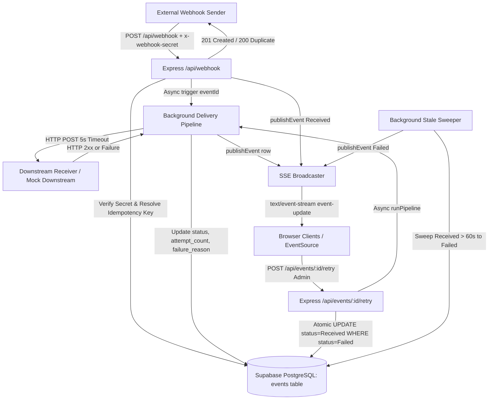

# EventBridge

EventBridge is an enterprise webhook ingestion, delivery, and real-time observability platform built with Node.js, Express, Supabase (PostgreSQL), and React.

Task ID: EventBridge

## Live Demo

- Production URL: <LIVE_URL>
- Demonstration Video: <VIDEO_URL>

Note: On the free hosting tier, the service automatically spins down after 15 minutes of inactivity. The first request after an idle period may take approximately 50 to 60 seconds to complete while the container boots.

## Credentials for Reviewer and Evaluation

The following credentials are configured for evaluation and testing:

- Administrator Password: `recruitingmewasyoursmartestdecision`
- Deployed Production Webhook Secret: `a3aa976dcbfb608f8a3e0d182cc40967548434e40a8f4c2c51b0f411ecaac7c2`

These credentials are also submitted separately through the project submission form.

## How a Reviewer Can Test It

Follow these numbered steps to test the full lifecycle of webhook ingestion, deduplication, failure simulation, authentication, and retry recovery.

Replace `<LIVE_URL>` with the deployment address (or `http://localhost:3000` when testing locally).

```bash
export BASE_URL="<LIVE_URL>"
export SECRET="a3aa976dcbfb608f8a3e0d182cc40967548434e40a8f4c2c51b0f411ecaac7c2"
```

### 1. Ingest a Valid Webhook

Send a standard webhook request containing a JSON payload and the shared secret header:

```bash
curl -i -X POST "$BASE_URL/api/webhook" \
  -H "Content-Type: application/json" \
  -H "x-webhook-secret: $SECRET" \
  -d '{"event": "order.created", "orderId": "ord_1001", "amount": 89.50}'
```

Expected response: `HTTP/1.1 201 Created`
```json
{
  "id": "<UUID>",
  "status": "Received",
  "duplicate": false
}
```

The background pipeline forwards this payload to the downstream service and transitions its status to `Completed` within 2 seconds.

### 2. Send the Exact Same Webhook Again (Deduplication Test)

Send the exact same request body a second time without an explicit idempotency key header:

```bash
curl -i -X POST "$BASE_URL/api/webhook" \
  -H "Content-Type: application/json" \
  -H "x-webhook-secret: $SECRET" \
  -d '{"event": "order.created", "orderId": "ord_1001", "amount": 89.50}'
```

Expected response: `HTTP/1.1 200 OK`
```json
{
  "id": "<SAME_UUID>",
  "status": "Completed",
  "duplicate": true
}
```

The system computes a SHA-256 fingerprint of the raw body, catches the unique constraint collision in PostgreSQL, updates the existing record timestamp, and skips downstream delivery.

### 3. Send an Unauthorized Webhook (Wrong Secret)

Send a webhook request with an invalid secret:

```bash
curl -i -X POST "$BASE_URL/api/webhook" \
  -H "Content-Type: application/json" \
  -H "x-webhook-secret: invalid_secret_token" \
  -d '{"event": "test"}'
```

Expected response: `HTTP/1.1 401 Unauthorized`
```json
{
  "error": "Unauthorized"
}
```

The request is rejected before reading or parsing the body payload.

### 4. Watch the Live Dashboard

Open `$BASE_URL` in any web browser. The dashboard connects to `GET /api/stream` using Server-Sent Events (SSE). New events appear live at the top of the table without refreshing the page.

### 5. Sign In as Administrator

Click the "Sign In" button in the upper right corner of the dashboard and enter the administrator password:

`recruitingmewasyoursmartestdecision`

Upon authentication, an `httpOnly`, `sameSite: strict` session cookie (`eventbridge_token`) is set. The dashboard reveals administrator controls, including full payload inspection, downstream simulation toggles, and manual retry actions.

Alternatively, authenticate via curl to save the cookie for CLI tests:

```bash
curl -i -c cookies.txt -X POST "$BASE_URL/api/login" \
  -H "Content-Type: application/json" \
  -d '{"password": "recruitingmewasyoursmartestdecision"}'
```

Expected response: `HTTP/1.1 200 OK`
```json
{
  "loggedIn": true,
  "webhookSecret": "<SECRET>"
}
```

### 6. Turn Mock Downstream Off (Simulate Outage)

Turn off the mock downstream receiver by toggling the "Downstream" indicator in the administrator navigation bar, or via curl:

```bash
curl -i -b cookies.txt -X POST "$BASE_URL/api/mock/mode" \
  -H "Content-Type: application/json" \
  -d '{"healthy": false}'
```

Expected response: `HTTP/1.1 200 OK`
```json
{
  "healthy": false
}
```

All open dashboards immediately reflect the downstream state change via SSE.

### 7. Create a Failed Event

Dispatch a new unique webhook while the downstream receiver is offline:

```bash
curl -i -X POST "$BASE_URL/api/webhook" \
  -H "Content-Type: application/json" \
  -H "x-webhook-secret: $SECRET" \
  -d '{"event": "payment.failed_test", "timestamp": "'$(date +%s)'"}'
```

The ingestion endpoint acknowledges receipt with `201 Created`. The background delivery pipeline attempts delivery, receives `503 Service Unavailable`, and updates the event status to `Failed`. The failure reason `Downstream returned status 503` is stored in Supabase and displayed on the dashboard.

### 8. Press Retry to Recover the Event

1. In the browser dashboard, click the row of the failed event to open the Event Payload Inspector drawer.
2. Observe the delivery failure banner and attempt counter.
3. Turn the mock downstream back on using the navigation pill (`{"healthy": true}`).
4. Click the "Retry Webhook Delivery" button.
5. The button transitions to "Triggering Retry..." while the server atomically claims the row (`status = 'Received'`).
6. The background delivery pipeline runs downstream delivery, succeeds with `200 OK`, updates the record to `status = 'Completed'`, and clears the failure reason.
7. If downstream remains offline, the retry attempt fails again, and the "Retry Webhook Delivery" button immediately re-enables for subsequent attempts.

Alternatively, trigger retry via curl using the event ID:

```bash
curl -i -b cookies.txt -X POST "$BASE_URL/api/events/<EVENT_UUID>/retry"
```

Expected response: `HTTP/1.1 202 Accepted`
```json
{
  "id": "<EVENT_UUID>",
  "status": "Received"
}
```

## Features Mapped to Requirements

| Requirement | Implementation Detail |
|---|---|
| Webhook Ingestion, Header Secret, and Idempotency | Express buffers raw request bytes to verify `x-webhook-secret` using timing-safe comparison, resolves an idempotency key from headers or SHA-256 body hashing, and performs an insert-then-catch on a PostgreSQL unique constraint to return 201 for new events and 200 for duplicates without executing duplicate downstream deliveries. |
| Live Dashboard with SSE | The backend exposes `GET /api/stream` using Server-Sent Events with persistent HTTP connections and 25-second heartbeat pings, broadcasting public event telemetry to browser `EventSource` listeners in real time. |
| Pipeline and Failure Handling | An asynchronous execution pipeline (`pipeline.js`) loads stored event rows, dispatches HTTP POST requests to the downstream consumer with an `AbortSignal` 5-second timeout, increments `attempt_count`, updates database status to `Completed` or `Failed`, and never throws unhandled exceptions. |
| Manual Retry with Double-Click Protection | The atomic endpoint `POST /api/events/:id/retry` executes a conditional update (`UPDATE events SET status = 'Received' WHERE id = :id AND status = 'Failed'`) to prevent race conditions, while the frontend uses synchronous ref locks (`isRetryingRef`) to block rapid double-clicks and re-enables the button immediately upon failure. |
| Public Deployment | The project is deployed as a single unified service on Render, where Express serves both the backend `/api/*` endpoints and the compiled React production bundle from `client/dist`, supported by an automated keepalive endpoint (`GET /api/keepalive`). |

## Architecture



### Event Lifecycle

1. **Received**: The incoming webhook passes secret verification, raw body validation, and idempotency checks. It is stored in Supabase with `status: 'Received'` and `attempt_count: 0`. The server publishes the `Received` row via SSE and returns `201 Created` immediately.
2. **Completed or Failed**: The background pipeline forwards the stored payload to `DOWNSTREAM_URL` with a 5-second timeout. If the downstream responds with HTTP 2xx, status transitions to `Completed`. If the downstream returns non-2xx, times out, or fails at the network layer, status transitions to `Failed` with an incremented `attempt_count` and a recorded `failure_reason`. The updated row is published over SSE.
3. **Manual Retry**: An authenticated administrator inspects a `Failed` event and clicks "Retry Webhook Delivery". The server executes an atomic conditional update setting `status: 'Received'`, broadcasts the change over SSE, and re-launches the delivery pipeline. If delivery fails again, the event returns to `Failed` and the retry button remains immediately available for further attempts.

## Tech Stack and Rationale

| Technology | Role | Rationale |
|---|---|---|
| React 19 + Vite | Frontend Dashboard | Rapid development, fast compilation, lightweight bundle size, and responsive client-side state synchronization with Server-Sent Events. |
| Node.js + Express | Backend Web Service | Mature middleware ecosystem allowing raw request byte buffering before JSON parsing, native async/await handling, and unified static SPA hosting. |
| Supabase (PostgreSQL) | Persistence Layer | Strict relational schema enforcement, ACID transactions, native UUID generation, and database-level unique constraints required for concurrency-safe idempotency and atomic state transitions. |
| Server-Sent Events (SSE) | Real-Time Telemetry | Webhook observability requires strictly one-way server-to-client streaming. SSE operates over standard HTTP (`text/event-stream`), includes built-in browser reconnection via `EventSource`, avoids WebSocket connection upgrade overhead, and works reliably through reverse proxies. |

## Design Decisions

- **Insert-Then-Catch for Idempotency**: Rather than performing a `SELECT` query followed by a conditional `INSERT` (which introduces a race condition between the read and write operations), the webhook route executes an immediate `INSERT` into the `events` table. PostgreSQL enforces a `UNIQUE` constraint on `idempotency_key`. If a duplicate arrives concurrently, the database returns error code `23505`. The catch block intercepts this code, updates `updated_at`, and returns `200 OK` with `duplicate: true`, completely eliminating race conditions.
- **Atomic Conditional UPDATE for Retry**: When an administrator retries an event, the server runs `UPDATE events SET status = 'Received', updated_at = now() WHERE id = :id AND status = 'Failed' RETURNING *`. PostgreSQL row-level locks guarantee that only one concurrent caller can change the row. If two administrators click retry simultaneously, only one query modifies a row; the other receives zero rows and returns `409 Conflict`.
- **Timing-Safe Secret Comparison**: Standard string comparison (`===`) terminates on the first mismatched byte, exposing secret lengths and prefix matches to timing analysis attacks. Both the expected and incoming secret strings are hashed with SHA-256 to fixed 32-byte buffers and evaluated using Node's `crypto.timingSafeEqual`, guaranteeing constant execution time.
- **httpOnly Cookie with Versioned JWT**: Administrator sessions are maintained using signed JSON Web Tokens stored in an `httpOnly`, `sameSite: 'strict'`, `secure` cookie named `eventbridge_token`. This protects session tokens from client-side script inspection (XSS defense) and cross-origin injection (CSRF defense). To allow instant global token invalidation without a database blocklist, each token embeds a numeric `auth_version`. The server increments `auth_version` in the database settings table during "Sign Out Everywhere", instantly invalidating older tokens across all devices.
- **Payload Privacy on Public APIs**: Public visitors can inspect system metrics, statuses, timestamps, and attempt counts via `GET /api/events` and the SSE stream. Raw ingested payloads and downstream error traces are strictly excluded from public responses to prevent exposure of customer PII or sensitive API data. Full payloads are accessible only through `GET /api/events/:id` protected by admin authentication.
- **Server-Sent Events over WebSockets**: The dashboard requires only downlink telemetry (server pushing database changes to clients). WebSockets introduce bidirectional overhead, custom connection upgrade handshakes, and stateful protocol management. SSE runs over standard HTTP, natively traverses firewalls and proxies, and features automatic reconnection.

## API Reference

| Method | Path | Auth Required | Purpose | Status Codes |
|---|---|---|---|---|
| GET | `/api/health` | None | Basic server liveness check (does not touch database) | 200 |
| GET | `/api/keepalive` | None | Lightweight database uptime ping (`SELECT id FROM events LIMIT 1`) | 200, 500 |
| POST | `/api/webhook` | `x-webhook-secret` header | Ingest incoming webhook with secret and idempotency validation | 201, 200, 400, 401, 500 |
| POST | `/api/mock-downstream` | None | Simulated destination endpoint (200 OK or 503 Outage) | 200, 503 |
| POST | `/api/mock-downstream/mode` | `x-webhook-secret` header | Secret-protected switch to toggle mock downstream health | 200, 400, 401, 500 |
| GET | `/api/mock/status` | None | Read current mock downstream health mode from database | 200, 500 |
| POST | `/api/mock/mode` | Admin Session Cookie | Toggle mock downstream health mode from admin UI | 200, 400, 401, 500 |
| POST | `/api/login` | Password body | Verify password, enforce IP rate limit, issue session cookie | 200, 400, 401, 429, 500 |
| POST | `/api/logout` | None | Clear `eventbridge_token` session cookie | 200 |
| GET | `/api/me` | None (inspects cookie) | Check whether current session has active admin authorization | 200, 500 |
| GET | `/api/events` | None | List 100 recent events (summary columns only, no payloads) | 200, 500 |
| GET | `/api/events/:id` | Admin Session Cookie | Retrieve full event record including payload and failure reason | 200, 400, 401, 404, 500 |
| POST | `/api/events/:id/retry` | Admin Session Cookie | Atomically claim and re-deliver a failed event | 202, 400, 401, 404, 409, 500 |
| POST | `/api/admin/clear-events` | Admin Session Cookie | Purge all events from database (`{"confirm": "DELETE ALL"}`) | 200, 400, 401, 500 |
| POST | `/api/admin/sign-out-everywhere` | Admin Session Cookie | Increment database `auth_version` to revoke all active tokens | 200, 401, 500 |
| GET | `/api/stream` | None | Server-Sent Events stream delivering live dashboard updates | 200 |

## Database Schema

The database consists of two tables created in Supabase PostgreSQL:

### 1. `events` Table

Stores ingested webhook deliveries, deduplication signatures, and lifecycle states.

```sql
CREATE TABLE events (
  id UUID PRIMARY KEY DEFAULT gen_random_uuid(),
  idempotency_key TEXT UNIQUE NOT NULL,
  payload JSONB NOT NULL,
  status TEXT NOT NULL DEFAULT 'Received',
  attempt_count INTEGER NOT NULL DEFAULT 0,
  failure_reason TEXT,
  created_at TIMESTAMPTZ NOT NULL DEFAULT now(),
  updated_at TIMESTAMPTZ NOT NULL DEFAULT now()
);

-- Index for ordering by recency
CREATE INDEX idx_events_created_at ON events (created_at DESC);

-- Index for atomic retry lookups and sweeper queries
CREATE INDEX idx_events_status_updated ON events (status, updated_at);
```

### 2. `settings` Table

Stores persistent runtime configuration surviving server restarts and multiple process instances.

```sql
CREATE TABLE settings (
  key TEXT PRIMARY KEY,
  value TEXT NOT NULL,
  updated_at TIMESTAMPTZ NOT NULL DEFAULT now()
);

-- Initial configuration records
INSERT INTO settings (key, value) VALUES
  ('mock_healthy', 'true'),
  ('auth_version', '1');
```

## Project Structure

```
EventBridge/
├── client/              # React + Vite frontend
│   ├── src/             # Dashboard components, telemetry, and sound engine
│   └── package.json
├── server/              # Express backend
│   ├── auth.js          # Shared secret verification and JWT auth helpers
│   ├── index.js         # Server entrypoint and route mounting
│   ├── mockDownstream.js# Mock receiver and outage simulation toggle
│   ├── pipeline.js      # Background delivery pipeline
│   ├── routes.js        # API routes (events, retry, auth, keepalive)
│   ├── settings.js      # Persistent key-value configuration in Supabase
│   ├── sse.js           # Server-Sent Events broadcaster and heartbeats
│   ├── supabase.js      # Supabase client and connection test
│   ├── sweeper.js       # Background stale event recovery sweeper
│   ├── webhook.js       # Webhook ingestion handler and idempotency logic
│   ├── .env.example     # Environment variable configuration template
│   └── package.json
├── .env.example         # Root environment variable template
├── package.json         # Unified build and start scripts for Render
└── README.md
```

## Local Setup

### Prerequisites

- Node.js (v18.0.0 or higher, tested with Node v20/v26)
- npm (v9.0.0 or higher)
- A Supabase project (or PostgreSQL instance with the schema above)

### 1. Clone the Repository

```bash
git clone <REPO_URL>
cd EventBridge
```


### 2. Configure Environment Variables

Create `server/.env` based on the configuration template below:

```bash
# Windows
copy server\.env.example server\.env

# Mac / Linux
cp server/.env.example server/.env
```

Configure the variable names in `server/.env`:

| Variable | Purpose |
|---|---|
| `PORT` | Local server listening port (default: `3000`). |
| `NODE_ENV` | Environment mode (`development` or `production`). |
| `SUPABASE_URL` | Base URL of your Supabase project (e.g. `https://xyz.supabase.co`). |
| `SUPABASE_SERVICE_ROLE_KEY` | Secret service role key with administrative database access. |
| `WEBHOOK_SECRET` | Secret token string required to authorize `POST /api/webhook`. |
| `ADMIN_PASSWORD` | Password required to log in to the administrator dashboard. |
| `SESSION_SECRET` | Secret key used to sign and verify JWT session cookies. |
| `DOWNSTREAM_URL` | Target endpoint for webhook forwarding (optional, defaults to local mock). |
| `DOWNSTREAM_DELAY_MS` | Artificial response delay in milliseconds for testing (default: `0`). |

### 3. Install Dependencies

Install dependencies across both client and server:

```bash
npm install --prefix client
npm install --prefix server
```

### 4. Run in Development Mode (Dual Process)

Run the backend Express server:

```bash
cd server
npm run dev
```

In a separate terminal, run the Vite development server:

```bash
cd client
npm run dev
```

Open `http://localhost:5173` in your browser.

### 5. Run Single-Port Unified Production Service

To test the unified production build locally:

```bash
npm run build
npm start
```

Open `http://localhost:3000` in your browser.

## Deployment Notes

EventBridge is configured for deployment as a single unified service on Render backed by Supabase.

### Build and Start Settings

- **Environment**: Node
- **Build Command**: `npm run build`  
  *(Installs client dependencies, compiles the Vite production bundle into `client/dist`, and installs server dependencies).*
- **Start Command**: `npm start`  
  *(Executes `node server/index.js`, serving the API and static frontend from host `0.0.0.0` on port `$PORT`).*

### Render Environment Variables

Configure the following environment variable names in the Render Dashboard under **Environment**:

- `NODE_ENV`: Set to `production`
- `SUPABASE_URL`: Supabase project URL
- `SUPABASE_SERVICE_ROLE_KEY`: Supabase service role secret key
- `WEBHOOK_SECRET`: Production webhook authorization secret
- `ADMIN_PASSWORD`: Administrator dashboard password
- `SESSION_SECRET`: Long random cryptographic string for JWT cookies
- `DOWNSTREAM_URL`: (Optional) Downstream destination. Defaults to `http://127.0.0.1:$PORT/api/mock-downstream`

### Uptime Keepalive Monitor

To prevent the Render free tier from idling after 15 minutes and to keep the Supabase connection warm, configure an external uptime monitor (such as UptimeRobot or cron-job.org) with:

- Target URL: `https://<YOUR_APP_NAME>.onrender.com/api/keepalive`
- Method: `GET`
- Interval: Every 5 to 10 minutes

## Known Limitations

- **In-Memory Background Pipeline & Stale Sweeper**: Webhook delivery runs asynchronously in the memory space of the active Node process. If the server crashes or restarts during delivery, the in-memory promise is lost, leaving the database row in the `Received` state. A background sweeper (`sweeper.js`) runs every 30 seconds and transitions any event stuck in `Received` for longer than 60 seconds to `Failed`, allowing an administrator to inspect and retry it. A distributed production architecture would replace in-memory execution with a persistent queue (such as Redis/BullMQ or AWS SQS).
- **In-Memory SSE Client Registry**: Active browser connections are tracked in an in-memory array (`clients[]`) on a single server process. In a multi-instance autoscaled environment, events ingested on instance A would not broadcast to browsers connected to instance B. Scaling horizontally requires an external pub/sub message broker (such as Redis Pub/Sub, PostgreSQL LISTEN/NOTIFY, or Supabase Realtime).
- **Single Shared Administrator Password**: Authentication relies on a single shared secret configured in `ADMIN_PASSWORD`. There are no multi-user profiles, individual account provisions, or granular role-based permissions.
- **Free-Tier Cold Starts**: On free hosting plans, instances spin down after inactivity, causing initial cold-start latency of up to 60 seconds on incoming requests.

## Branches

| Branch | Status | Contents |
|---|---|---|
| `main` | Deployed | Active production branch containing the full Express backend, React client, unified Render single-service deployment, keepalive monitor, and retry re-usability bugfix. |
| `UI-testing` | Not merged / Not deployed | Experimental feature branch containing UI redesign prototypes, Web Audio sound synthesis, and Webhook Studio presets. Stable changes were incorporated into main. |

## Credits and References

| Resource | URL | Purpose |
|---|---|---|
| MDN Webhooks Glossary | https://developer.mozilla.org/en-US/docs/Glossary/Webhook | Architectural reference for webhook receiving and verification patterns. |
| MDN Server-Sent Events | https://developer.mozilla.org/en-US/docs/Web/API/Server-sent_events | Standard specification for `EventSource` and `text/event-stream` protocols. |
| Express Documentation | https://expressjs.com/ | Node.js routing, raw body buffering, and static file serving. |
| Supabase JavaScript Client | https://supabase.com/docs/reference/javascript | PostgreSQL data queries, error handling, and connection initialization. |
| Supabase Realtime & Architecture | https://supabase.com/docs/guides/realtime | Relational design and PostgreSQL database connection management. |
| Render Documentation | https://render.com/docs | Single-service web deployment configuration and build scripts. |
| jsonwebtoken | https://github.com/auth0/node-jsonwebtoken | Signing, verifying, and decoding JWT session cookies. |
| canvas-confetti | https://github.com/catdad/canvas-confetti | Lightweight micro-animations for user action feedback. |
| Lucide React | https://lucide.dev/ | Dashboard iconography and telemetry status indicators. |
| Tailwind CSS | https://tailwindcss.com/ | Modern utility classes for responsive dashboard layout. |
| Vite | https://vite.dev/ | Frontend compilation, bundling, and local development server. |
| Additional References | <ADD ANY TUTORIAL OR REPO I USED> | Placeholder for external tutorials or reference repositories consulted. |

## What I Learned

- **Idempotency**: <WRITE WHAT YOU LEARNED ABOUT IDEMPOTENCY AND INSERT-THEN-CATCH CONCURRENCY>
- **Server-Sent Events**: <WRITE WHAT YOU LEARNED ABOUT SSE VS WEBSOCKETS FOR UNIDIRECTIONAL TELEMETRY>
- **Concurrency & Atomicity**: <WRITE WHAT YOU LEARNED ABOUT ATOMIC CONDITIONAL SQL UPDATES FOR CLAIMING RETRIES>
- **Unified Deployment**: <WRITE WHAT YOU LEARNED ABOUT SERVING SINGLE-PAGE APPS AND APIS FROM ONE EXPRESS SERVICE>
