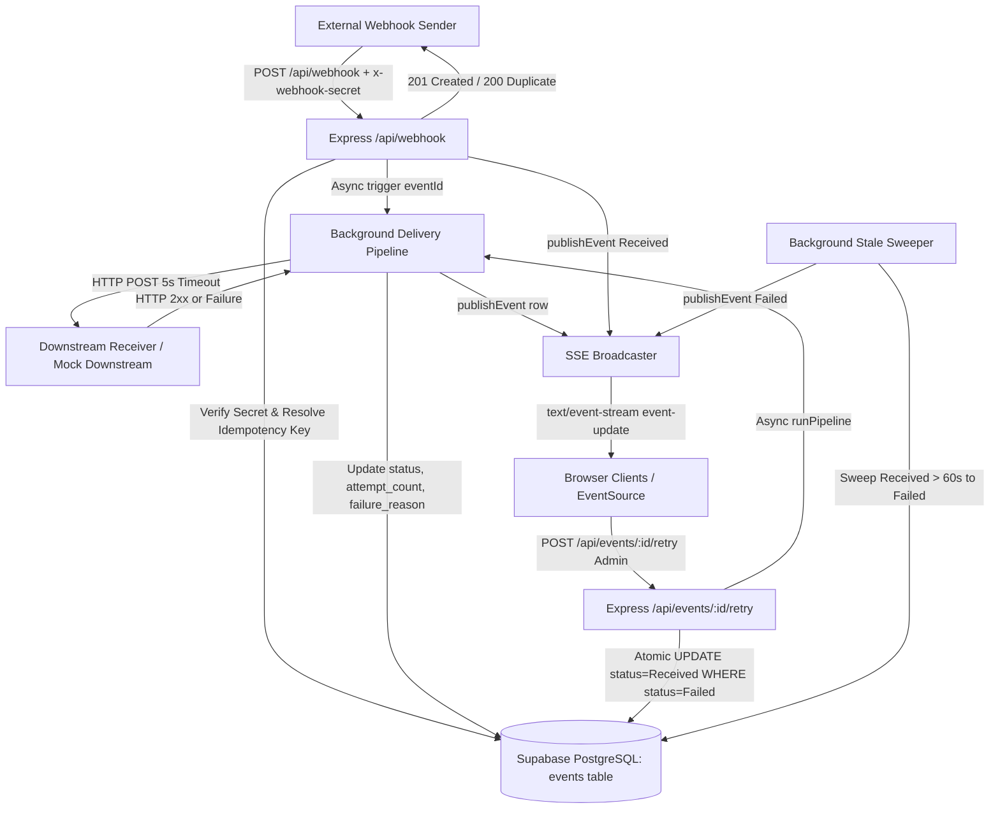

<h1 align="center">EventBridge</h1>


<h2 align="center"><strong>Reliable webhook ingestion, delivery, and real-time observability platform.</strong><br>Task ID: EventBridge</h2>

<details>
<summary style="font-size: 20px; font-weight: bold; cursor: pointer;">Table of Contents</summary>

- [Architecture Diagram](#architecture-diagram)
- [Live Demo & Video](#live-demo--video)
- [Project Structure](#project-structure)
- [Credentials for Reviewer and Evaluation](#credentials-for-reviewer-and-evaluation)
- [The Problem](#the-problem)
- [Our Solution](#our-solution)
- [What Gets Stored on the Server (Database Schema)](#what-gets-stored-on-the-server-database-schema)
- [Design Decisions & Technical Trade-offs](#design-decisions--technical-trade-offs)
- [How a Reviewer Can Test It](#how-a-reviewer-can-test-it)
- [Tech Stack and Rationale](#tech-stack-and-rationale)
- [API Reference](#api-reference)
- [Local Setup Guide](#local-setup-guide)
- [Deployment](#deployment)
- [Known Limitations](#known-limitations)
- [Branches](#branches)
- [Credits and References](#credits-and-references)
- [What I Learned](#what-i-learned)
- [License](#license)

</details>

---

## Architecture Diagram



---

## Live Demo & Video

- **Production URL**: [<LIVE_URL>](https://eventbridge-bgcp.onrender.com/)
- **Demonstration Video**: <VIDEO_URL>

Note: On the free cloud hosting tier (Render), the application container automatically spins down after 15 minutes of inactivity. The initial HTTP request after an idle window may take approximately 50 to 60 seconds while the container initializes.

---

## Project Structure

```
EventBridge/
├── assets/              # Repository media assets and brand logo
├── client/              # React + Vite frontend
│   ├── src/             # Dashboard components, telemetry, and sound engine
│   └── package.json
├── server/              # Express backend
│   ├── auth.js          # Shared secret verification and JWT auth helpers
│   ├── index.js         # Server entrypoint and route mounting
│   ├── mockDownstream.js# Mock receiver and outage simulation toggle
│   ├── pipeline.js      # Background delivery pipeline
│   ├── routes.js        # API routes (events, retry, auth, keepalive)
│   ├── settings.js      # Persistent key-value configuration in Supabase
│   ├── sse.js           # Server-Sent Events broadcaster and heartbeats
│   ├── supabase.js      # Supabase client and connection test
│   ├── sweeper.js       # Background stale event recovery sweeper
│   ├── webhook.js       # Webhook ingestion handler and idempotency logic
│   ├── .env.example     # Environment variable configuration template
│   └── package.json
├── .env.example         # Root environment variable template
├── package.json         # Unified build and start scripts for Render
└── README.md
```

---

## Credentials for Reviewer and Evaluation

The following credentials are configured for evaluation and grading:

- **Administrator Password**: `recruitingmewasyoursmartestdecision`
- **Deployed Production Webhook Secret**: `a3aa976dcbfb608f8a3e0d182cc40967548434e40a8f4c2c51b0f411ecaac7c2`

---

## The Problem

Modern distributed applications rely heavily on webhooks for asynchronous integration across payment processors, version control, and SaaS platforms. Traditional naive webhook receivers face recurring operational failures:

- **Missing Idempotency**: Network retries from upstream providers cause identical payloads to execute multiple times, creating duplicate invoices, duplicate orders, or corrupted account states.
- **Vulnerability to Timing Attacks**: Naive string comparisons on incoming authentication tokens expose secret lengths and character prefixes through execution time differences.
- **Blocking Ingestion**: Calling downstream destination APIs synchronously during webhook receipt causes timeouts on the sender side and degrades throughput.
- **Silent Abandonment on Crashes**: Background promises running in Node memory terminate when servers reboot or restart, leaving in-flight events stuck in intermediate states indefinitely.
- **Race Conditions on Manual Retries**: When multiple administrators or automated scripts trigger retries simultaneously, naive select-then-update logic allows duplicate delivery runs to execute in parallel.
- **Payload Data Leakage**: Exposing raw webhook bodies over public telemetry streams leaks customer PII and authorization tokens to unauthorized observers.

---

## Our Solution

EventBridge resolves these challenges through a hardened ingestion and telemetry architecture:

1. **Authenticated Ingestion with Deduplication**: Validates raw request bytes before JSON parsing using constant-time comparisons, resolves an idempotency signature, and enforces database uniqueness constraints. New events return `201 Created`; duplicates return `200 OK` and skip downstream delivery.
2. **Decoupled Asynchronous Delivery Pipeline**: Ingestion responds immediately upon database persistence, offloading delivery to a background worker with a strict 5-second `AbortSignal` timeout.
3. **Atomic Conditional Retry Engine**: Single-statement SQL updates ensure only one concurrent worker claims a failed event. Synchronous frontend ref locks prevent rapid double-clicks while remaining immediately re-usable upon completion.
4. **Real-Time Telemetry via Server-Sent Events (SSE)**: Monotonic state transitions (`Received` -> `Completed` / `Failed`) stream live to connected browsers using unidirectional HTTP `text/event-stream` with 25-second heartbeat keepalives.
5. **Stale In-Flight Sweeper**: A recurring background sweeper identifies events left in `Received` status for over 60 seconds due to process restarts and transitions them to `Failed` for safe administrator inspection.
6. **Role-Protected Telemetry Projections**: Public views display status badges, timestamps, and attempt counts; sensitive raw payloads and failure diagnostics are restricted to authenticated admin sessions.

---

## What Gets Stored on the Server (Database Schema)

EventBridge stores only operational metadata and incoming payloads across two tables in Supabase PostgreSQL:

### 1. `events` Table

| Column | Type | Constraints | Description |
|---|---|---|---|
| `id` | UUID | PRIMARY KEY | Unique event identifier (`gen_random_uuid()`) |
| `idempotency_key` | TEXT | UNIQUE, NOT NULL | Deduplication key (from header or SHA-256 body hash) |
| `payload` | JSONB | NOT NULL | Raw ingested webhook payload |
| `status` | TEXT | NOT NULL | Current lifecycle state (`'Received'`, `'Completed'`, `'Failed'`) |
| `attempt_count` | INTEGER | NOT NULL | Total delivery attempts (defaults to `0`) |
| `failure_reason` | TEXT | NULLABLE | Downstream error message or timeout trace |
| `created_at` | TIMESTAMPTZ | NOT NULL | Initial ingestion timestamp (`now()`) |
| `updated_at` | TIMESTAMPTZ | NOT NULL | Timestamp of last state change (`now()`) |

- **Indexes**:
  - `idx_events_created_at` on `created_at DESC` (fast paginated telemetry listing)
  - `idx_events_status_updated` on `(status, updated_at)` (fast stale-event sweep queries)
- **Privacy Policy**: The raw `payload` and `failure_reason` columns are omitted from public API queries and SSE events.

### 2. `settings` Table

| Column | Type | Constraints | Description |
|---|---|---|---|
| `key` | TEXT | PRIMARY KEY | Configuration key name (`mock_healthy`, `auth_version`) |
| `value` | TEXT | NOT NULL | Serialized setting value |
| `updated_at` | TIMESTAMPTZ | NOT NULL | Last modification timestamp |

---

## Design Decisions & Technical Trade-offs

- **Insert-Then-Catch vs Read-Then-Write**: Rather than querying before inserting (which creates a race condition window under concurrent requests), the ingestion route performs a direct `INSERT`. PostgreSQL enforces the unique constraint on `idempotency_key`. Collisions trigger error `23505`, which is caught to update timestamps and return `200 OK` with `duplicate: true`.
- **Atomic Conditional UPDATE vs Application Locking**: To eliminate duplicate parallel retries without distributed lock infrastructure, the server runs `UPDATE events SET status = 'Received', updated_at = now() WHERE id = :id AND status = 'Failed' RETURNING *`. PostgreSQL row locks ensure exactly one caller wins the claim; concurrent callers receive an immediate `409 Conflict`.
- **Constant-Time Verification vs String Comparison**: JavaScript string equality (`===`) exits early on the first mismatched byte, creating a timing attack vulnerability. We hash both strings with SHA-256 into 32-byte buffers and evaluate with `crypto.timingSafeEqual` for constant execution time.
- **Versioned JWT Cookies vs Database Blacklists**: Admin sessions use `httpOnly`, `sameSite: 'strict'`, `secure` cookies containing an `auth_version` claim. Global revocation ("Sign Out Everywhere") increments a single integer in the `settings` table, instantly invalidating all issued tokens across devices without tracking per-token blacklists.
- **Server-Sent Events vs WebSockets**: The dashboard requires only one-way server-to-browser telemetry. SSE operates over standard HTTP, traverses proxies without protocol upgrade negotiation, and includes built-in browser reconnection logic.

---

## How a Reviewer Can Test It

Follow these numbered steps using curl to test the entire operational flow.

Replace `<LIVE_URL>` with your deployed domain (or `http://localhost:3000` for local runs):

```bash
export BASE_URL="<LIVE_URL>"
export SECRET="a3aa976dcbfb608f8a3e0d182cc40967548434e40a8f4c2c51b0f411ecaac7c2"
```

### 1. Ingest a Valid Webhook

```bash
curl -i -X POST "$BASE_URL/api/webhook" \
  -H "Content-Type: application/json" \
  -H "x-webhook-secret: $SECRET" \
  -d '{"event": "order.created", "orderId": "ord_1001", "amount": 89.50}'
```

Expected response: `HTTP/1.1 201 Created`
```json
{
  "id": "<UUID>",
  "status": "Received",
  "duplicate": false
}
```

### 2. Send the Same Webhook Again (Deduplication Check)

```bash
curl -i -X POST "$BASE_URL/api/webhook" \
  -H "Content-Type: application/json" \
  -H "x-webhook-secret: $SECRET" \
  -d '{"event": "order.created", "orderId": "ord_1001", "amount": 89.50}'
```

Expected response: `HTTP/1.1 200 OK`
```json
{
  "id": "<SAME_UUID>",
  "status": "Completed",
  "duplicate": true
}
```

### 3. Send Request with an Invalid Secret (401 Check)

```bash
curl -i -X POST "$BASE_URL/api/webhook" \
  -H "Content-Type: application/json" \
  -H "x-webhook-secret: invalid_secret_token" \
  -d '{"event": "test"}'
```

Expected response: `HTTP/1.1 401 Unauthorized`
```json
{
  "error": "Unauthorized"
}
```

### 4. Watch the Dashboard

Open `$BASE_URL` in a browser. Ingested events appear in real time via Server-Sent Events without manual page refreshes.

### 5. Sign In as Administrator

Authenticate to obtain an `httpOnly` admin session cookie:

```bash
curl -i -c cookies.txt -X POST "$BASE_URL/api/login" \
  -H "Content-Type: application/json" \
  -d '{"password": "recruitingmewasyoursmartestdecision"}'
```

Expected response: `HTTP/1.1 200 OK`
```json
{
  "loggedIn": true,
  "webhookSecret": "<SECRET>"
}
```

### 6. Turn Mock Downstream Off (Simulate Outage)

```bash
curl -i -b cookies.txt -X POST "$BASE_URL/api/mock/mode" \
  -H "Content-Type: application/json" \
  -d '{"healthy": false}'
```

Expected response: `HTTP/1.1 200 OK`
```json
{
  "healthy": false
}
```

### 7. Create a Failed Event

Dispatch a unique event while downstream is offline:

```bash
curl -i -X POST "$BASE_URL/api/webhook" \
  -H "Content-Type: application/json" \
  -H "x-webhook-secret: $SECRET" \
  -d '{"event": "payment.failed_test", "timestamp": "'$(date +%s)'"}'
```

Ingestion returns `201 Created`. The background delivery pipeline receives `503 Service Unavailable`, transitions status to `Failed`, and logs the failure trace.

### 8. Press Retry to Recover the Event

Restore downstream health and trigger an immediate retry:

```bash
curl -i -b cookies.txt -X POST "$BASE_URL/api/mock/mode" \
  -H "Content-Type: application/json" \
  -d '{"healthy": true}'

curl -i -b cookies.txt -X POST "$BASE_URL/api/events/<EVENT_UUID>/retry"
```

Expected response: `HTTP/1.1 202 Accepted`
```json
{
  "id": "<EVENT_UUID>",
  "status": "Received"
}
```

The pipeline re-delivers the payload, succeeds with `200 OK`, transitions status to `Completed`, and clears the failure reason.

---

## Tech Stack and Rationale

| Technology | Role | Rationale |
|---|---|---|
| React 19 + Vite | Frontend Dashboard | Rapid local builds, minimal bundle footprint, responsive state management, and component modularity. |
| Node.js + Express | Backend Application Server | Middleware ordering flexibility allowing raw body buffering before JSON parsing, native async/await, and single-port SPA serving. |
| Supabase (PostgreSQL) | Database & Storage | ACID transactions, native UUID generation, strict unique constraints for deduplication, and atomic conditional update semantics. |
| Server-Sent Events (SSE) | Real-Time Broadcast | Unidirectional server-to-client streaming via standard HTTP (`text/event-stream`), built-in browser reconnection, and zero WebSocket gateway complexity. |

---

## API Reference

| Method | Path | Auth Required | Purpose | Status Codes |
|---|---|---|---|---|
| GET | `/api/health` | None | Basic server liveness check (does not query database) | 200 |
| GET | `/api/keepalive` | None | Lightweight database uptime ping (`SELECT id FROM events LIMIT 1`) | 200, 500 |
| POST | `/api/webhook` | `x-webhook-secret` header | Ingest incoming webhook with secret and idempotency validation | 201, 200, 400, 401, 500 |
| POST | `/api/mock-downstream` | None | Simulated destination endpoint (200 OK or 503 Outage) | 200, 503 |
| POST | `/api/mock-downstream/mode` | `x-webhook-secret` header | Secret-protected switch to toggle mock downstream health | 200, 400, 401, 500 |
| GET | `/api/mock/status` | None | Read current mock downstream health mode from database | 200, 500 |
| POST | `/api/mock/mode` | Admin Session Cookie | Toggle mock downstream health mode from admin UI | 200, 400, 401, 500 |
| POST | `/api/login` | Password body | Verify password, enforce IP rate limit, issue session cookie | 200, 400, 401, 429, 500 |
| POST | `/api/logout` | None | Clear `eventbridge_token` session cookie | 200 |
| GET | `/api/me` | None (inspects cookie) | Check whether current session has active admin authorization | 200, 500 |
| GET | `/api/events` | None | List 100 recent events (summary columns only, no payloads) | 200, 500 |
| GET | `/api/events/:id` | Admin Session Cookie | Retrieve full event record including payload and failure reason | 200, 400, 401, 404, 500 |
| POST | `/api/events/:id/retry` | Admin Session Cookie | Atomically claim and re-deliver a failed event | 202, 400, 401, 404, 409, 500 |
| POST | `/api/admin/clear-events` | Admin Session Cookie | Purge all events from database (`{"confirm": "DELETE ALL"}`) | 200, 400, 401, 500 |
| POST | `/api/admin/sign-out-everywhere` | Admin Session Cookie | Increment database `auth_version` to revoke all active tokens | 200, 401, 500 |
| GET | `/api/stream` | None | Server-Sent Events stream delivering live dashboard updates | 200 |

---

## Local Setup Guide

### 1. Prerequisites

- Node.js (v18.0.0 or higher, tested with Node v20/v26)
- npm (v9.0.0 or higher)
- A Supabase project (or PostgreSQL instance with the schema above)

### 2. Clone the Repository

```bash
git clone <REPO_URL>
cd EventBridge
```

### 3. Configure Environment Variables

Copy the environment template in the `server` directory:

```bash
# Windows
copy server\.env.example server\.env

# Mac / Linux
cp server/.env.example server/.env
```

Configure the variable values in `server/.env`:

| Variable | Purpose |
|---|---|
| `PORT` | Local server listening port (default: `3000`). |
| `NODE_ENV` | Environment mode (`development` or `production`). |
| `SUPABASE_URL` | Base URL of your Supabase project (e.g. `https://xyz.supabase.co`). |
| `SUPABASE_SERVICE_ROLE_KEY` | Secret service role key with administrative database access. |
| `WEBHOOK_SECRET` | Secret token string required to authorize `POST /api/webhook`. |
| `ADMIN_PASSWORD` | Password required to log in to the administrator dashboard. |
| `SESSION_SECRET` | Secret key used to sign and verify JWT session cookies. |
| `DOWNSTREAM_URL` | Target endpoint for webhook forwarding (optional, defaults to local mock). |
| `DOWNSTREAM_DELAY_MS` | Artificial response delay in milliseconds for testing (default: `0`). |

### 4. Install Dependencies

```bash
npm install --prefix client
npm install --prefix server
```

### 5. Run in Development Mode (Dual Process)

Run the backend Express server:

```bash
cd server
npm run dev
```

In a separate terminal, run the Vite development server:

```bash
cd client
npm run dev
```

Open `http://localhost:5173` in your browser.

### 6. Run Single-Port Unified Production Service

To test the unified production build locally:

```bash
npm run build
npm start
```

Open `http://localhost:3000` in your browser.

---

## Deployment

EventBridge is configured for deployment as a single unified service on Render backed by Supabase.

### Build and Start Settings

- **Environment**: Node
- **Build Command**: `npm run build`  
  *(Installs client dependencies, compiles the Vite production bundle into `client/dist`, and installs server dependencies).*
- **Start Command**: `npm start`  
  *(Executes `node server/index.js`, serving the API and static frontend from host `0.0.0.0` on port `$PORT`).*

### Render Environment Variables

In the Render Dashboard under **Environment**, set `NODE_ENV=production` and provide the runtime credentials (`SUPABASE_URL`, `SUPABASE_SERVICE_ROLE_KEY`, `WEBHOOK_SECRET`, `ADMIN_PASSWORD`, `SESSION_SECRET`, and optional `DOWNSTREAM_URL`) as specified in the [Local Setup Guide](#3-configure-environment-variables).

### Uptime Keepalive Monitor

To prevent the Render free tier from idling after 15 minutes and to keep the Supabase connection warm, configure an external uptime monitor (such as UptimeRobot or cron-job.org) with:

- Target URL: `https://<YOUR_APP_NAME>.onrender.com/api/keepalive`
- Method: `GET`
- Interval: Every 5 to 10 minutes

---

## Known Limitations

- **In-Memory Background Pipeline & Stale Sweeper**: Webhook delivery runs asynchronously in the memory space of the active Node process. If the server crashes or restarts during delivery, the in-memory promise is lost, leaving the database row in the `Received` state. A background sweeper (`sweeper.js`) runs every 30 seconds and transitions any event stuck in `Received` for longer than 60 seconds to `Failed`, allowing an administrator to inspect and retry it. A distributed production architecture would replace in-memory execution with a persistent queue (such as Redis/BullMQ or AWS SQS).
- **In-Memory SSE Client Registry**: Active browser connections are tracked in an in-memory array (`clients[]`) on a single server process. In a multi-instance autoscaled environment, events ingested on instance A would not broadcast to browsers connected to instance B. Scaling horizontally requires an external pub/sub message broker (such as Redis Pub/Sub, PostgreSQL LISTEN/NOTIFY, or Supabase Realtime).
- **Single Shared Administrator Password**: Authentication relies on a single shared secret configured in `ADMIN_PASSWORD`. There are no multi-user profiles, individual account provisions, or granular role-based permissions.
- **Free-Tier Cold Starts**: On free hosting plans, instances spin down after inactivity, causing initial cold-start latency of up to 60 seconds on incoming requests.

---

## Branches

| Branch | Status | Contents |
|---|---|---|
| `main` | Deployed | Active production branch containing the full Express backend, React client, unified Render single-service deployment, keepalive monitor, and retry re-usability bugfix. |
| `UI-testing` | Not merged / Not deployed | Experimental feature branch containing UI redesign prototypes, Web Audio sound synthesis, and Webhook Studio presets. Stable changes were incorporated into main. |

---

## Credits and References

| Resource | URL | Purpose |
|---|---|---|
| MDN Webhooks Glossary | https://developer.mozilla.org/en-US/docs/Glossary/Webhook | Architectural reference for webhook receiving and verification patterns. |
| MDN Server-Sent Events | https://developer.mozilla.org/en-US/docs/Web/API/Server-sent_events | Standard specification for `EventSource` and `text/event-stream` protocols. |
| Express Documentation | https://expressjs.com/ | Node.js routing, raw body buffering, and static file serving. |
| Supabase JavaScript Client | https://supabase.com/docs/reference/javascript | PostgreSQL data queries, error handling, and connection initialization. |
| Supabase Realtime & Architecture | https://supabase.com/docs/guides/realtime | Relational design and PostgreSQL database connection management. |
| Render Documentation | https://render.com/docs | Single-service web deployment configuration and build scripts. |
| jsonwebtoken | https://github.com/auth0/node-jsonwebtoken | Signing, verifying, and decoding JWT session cookies. |
| canvas-confetti | https://github.com/catdad/canvas-confetti | Lightweight micro-animations for user action feedback. |
| Lucide React | https://lucide.dev/ | Dashboard iconography and telemetry status indicators. |
| Tailwind CSS | https://tailwindcss.com/ | Modern utility classes for responsive dashboard layout. |
| Vite | https://vite.dev/ | Frontend compilation, bundling, and local development server. |

---

## What I Learned

- **Idempotency**: <WRITE WHAT YOU LEARNED ABOUT IDEMPOTENCY AND INSERT-THEN-CATCH CONCURRENCY>
- **Server-Sent Events**: <WRITE WHAT YOU LEARNED ABOUT SSE VS WEBSOCKETS FOR UNIDIRECTIONAL TELEMETRY>
- **Concurrency & Atomicity**: <WRITE WHAT YOU LEARNED ABOUT ATOMIC CONDITIONAL SQL UPDATES FOR CLAIMING RETRIES>
- **Unified Deployment**: <WRITE WHAT YOU LEARNED ABOUT SERVING SINGLE-PAGE APPS AND APIS FROM ONE EXPRESS SERVICE>

---

## License

MIT. See [LICENSE](LICENSE).
