# EventBridge UI/UX Redesign: Complete Visual Catalog

> **Current Official Shortlist**:
> 1. 🏆 **Concept 8**: Cyberpunk Tactical Operations HUD (Laser Cyan/Amber, 45° Chamfers, Targeting Reticle Brackets, Delivery Route Tree)
> 2. 🏆 **Option 14**: 16-Bit Arcade Engine & Chiptune Console (Chunky Arcade Scoreboards, Equalizer Visualizer, `[1-UP RETRY]`)
>
> **Core Constraint**: All designs strictly adhere to the **zero gradients rule** (100% solid flat surfaces, tactile geometry, crisp line work, high-contrast typography, and zero blur).

---

## Quick Navigation
- [🏆 The Shortlisted Champions](#1-the-shortlisted-champions)
- [⚔️ Category A: Tactical, Cybernetic & Sci-Fi HUDs](#2-category-a-tactical-cybernetic--sci-fi-huds)
- [🕹️ Category B: Retro Gaming & Handheld Consoles](#3-category-b-retro-gaming--handheld-consoles)
- [🎛️ Category C: Physical Hardware & Studio Audio Consoles](#4-category-c-physical-hardware--studio-audio-consoles)
- [🏛️ Category D: Modernist, Editorial & Architectural Consoles](#5-category-d-modernist-editorial--architectural-consoles)
- [📜 Category E: Initial Explorations (Historical Reference)](#6-category-e-initial-explorations-historical-reference)
- [📊 Comprehensive Comparison Matrix](#7-comprehensive-comparison-matrix)
- [🚀 Implementation Readiness Guide](#8-implementation-readiness-guide)

---

## 1. The Shortlisted Champions

### 🏆 Concept 8: Cyberpunk Tactical Operations HUD *(Champion #1)*

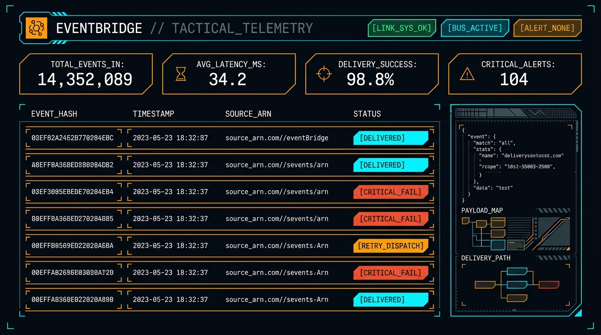

- **Aesthetic**: *Ghost in the Shell* Netrunner HUD / Orbital Defense Command Deck.
- **Palette**: Pitch Void (`#050810`), Laser Cyan (`#00F0FF`), Warning Amber (`#FFA500`), Neon Crimson (`#FF2E54`).
- **Geometry**: **45-degree chamfered corners** cut on top-left and bottom-right of metric cards and headers.
- **Table & Rows**: Each event row is framed with tactical targeting corner brackets: `┌ [03EF82452B] ... [DELIVERED] ┐`.
- **Payload Inspector**: Interactive **Delivery Route Path Tree** (`PAYLOAD_MAP` + `DELIVERY_PATH`) visually tracing events through the queue.
- **Action Button**: Clean tech badges with solid cyan / amber fills (`[RETRY_DISPATCH]`).

---

### 🏆 Option 14: 16-Bit Neo-Geo Arcade Engine & Chiptune Console *(Champion #2)*

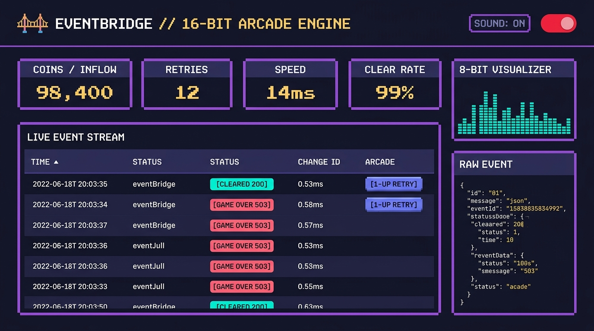

- **Aesthetic**: 1990s Capcom CPS-2 / SNK Neo-Geo Arcade Operator Menu & Chiptune Dev Console.
- **Palette**: Dark Arcade Indigo (`#121324`), Neon Purple (`#9D4EDD`), Arcade Cyan (`#00F5D4`), Pixel Gold (`#FFD166`).
- **Scoreboard Metric Blocks**: Arcade scoreboard styling (`COINS / INFLOW: 98,400`, `RETRIES: 12`, `SPEED: 14ms`, `CLEAR RATE: 99%`).
- **Interactive Equalizer**: Real-time **8-Bit Equalizer Spectrum Visualizer** that pulses with every audio chime.
- **Action Button**: Chunky arcade cabinet push-button: **[1-UP RETRY]**.
- **Status Badges**: `[CLEARED 200]` in neon cyan and `[GAME OVER 503]` in arcade berry red.

---

## 2. Category A: Tactical, Cybernetic & Sci-Fi HUDs

### Concept 8A: Evangelion NERV / MAGI Tactical Command Node

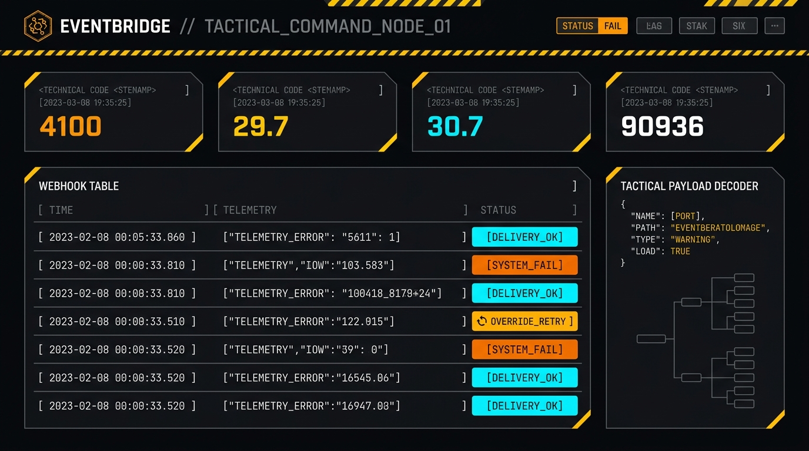

- **Aesthetic**: *Neon Genesis Evangelion* MAGI Supercomputer / Strategic Military Defense Center.
- **Palette**: Void Charcoal (`#0E1015`) + Safety Amber (`#FFB800`) + Emergency Alert Orange (`#FF5500`) + Terminal Cyan (`#00E5FF`).
- **Key Features**: Diagonal hazard warning stripe banner, prominent tactile `[ ⟳ OVERRIDE_RETRY ]` amber button, technical timestamp badges, and hierarchical tree payload decoder.

---

### Concept 8B: Arasaka Cyberdeck / Netrunner OS

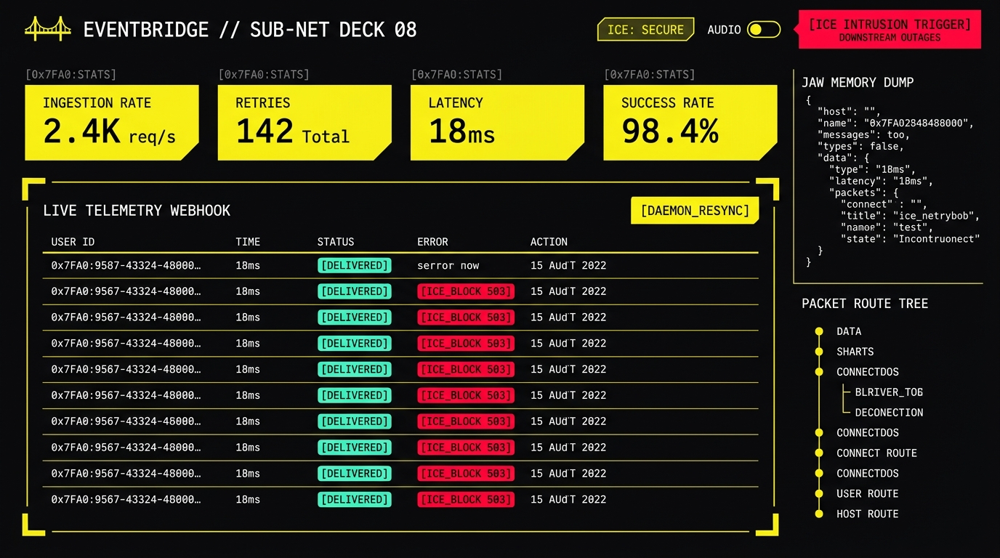

- **Aesthetic**: *Cyberpunk 2077* Cyberdeck Infiltration Rig & Quickhack Console.
- **Palette**: Pitch Obsidian (`#0A0A0C`) + Flat Acid Yellow (`#FCEE0A`) + Signal Red (`#FF003C`) + Cyan (`#00F0FF`).
- **Key Features**: Memory address tags `[0x7FA0:STATS]`, `[ICE INTRUSION TRIGGER]` outage emergency switch, `[DAEMON_RESYNC]` action button, and raw memory dump with node connector tree.

---

### Concept 8C: Spacecraft Avionics Glass Cockpit

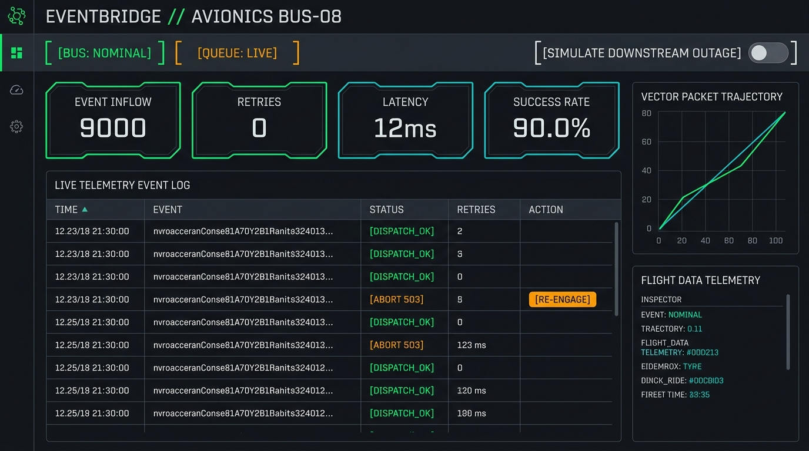

- **Aesthetic**: NASA Apollo / Artemis Glass Cockpit Flight Deck.
- **Palette**: Dark Cockpit Slate (`#111418`) + Phosphor Vector Green (`#00FF66`) + Radar Cyan (`#00D2D3`) + Aerospace Amber.
- **Key Features**: Backlit rectangular annunciator warning tiles (`[BUS: NOMINAL]`, `[QUEUE: LIVE]`), live vector packet trajectory curve, precision beveled bezels, and `[RE-ENGAGE]` button.

---

### Concept 8D: WipEout / The Designers Republic (tDR) Graphic HUD

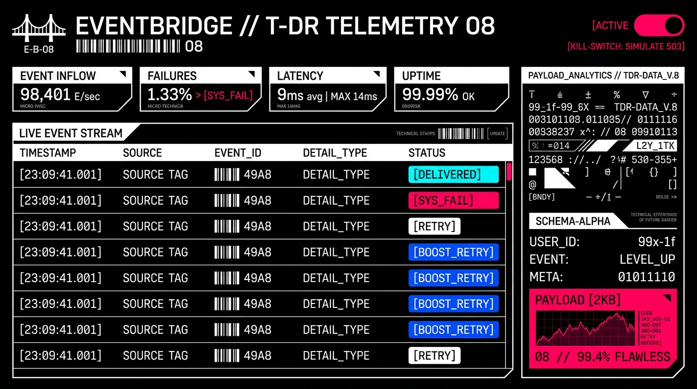

- **Aesthetic**: Y2K Futuristic Anti-Gravity Racing Telemetry / Radical Swiss Graphic Design.
- **Palette**: Stark Monochrome (`#000000` / `#FFFFFF`) + Fluorescent Electric Magenta (`#FF0055`) + Cobalt Blue (`#0055FF`).
- **Key Features**: Barcode serial identifiers (`||||| ||| 08`), vertical technical stamps, rapid telemetry tickers, and electric cobalt `[BOOST_RETRY]` buttons.

---

### Option 16: Armored Core / Gundam Mecha Cockpit Tactical OS

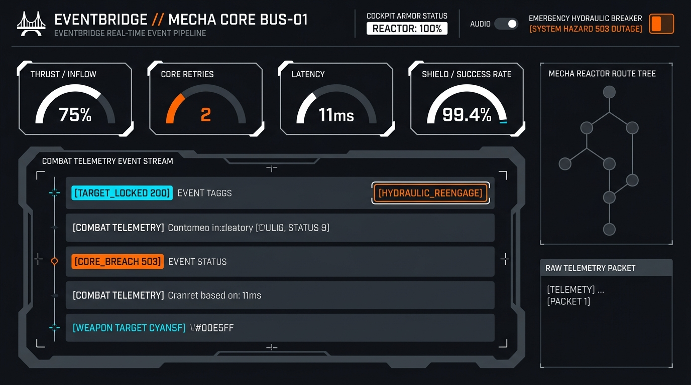

- **Aesthetic**: High-tech Combat Mecha / Mobile Suit Cockpit HUD (*Armored Core 6* / *Gundam*).
- **Palette**: Stealth Armor Carbon (`#0E1117`) + Industrial Hazard Orange (`#FF6B00`) + Target Lock Cyan (`#00E5FF`).
- **Key Features**: Circular flat arc progress gauges, heavy exoskeleton frame with targeting crosshairs, hydraulic breaker switch, `[HYDRAULIC_REENGAGE]` button, and mecha reactor route tree.

---

### Option 18: Weyland-Yutani MU-TH-UR 6000 Ship Terminal

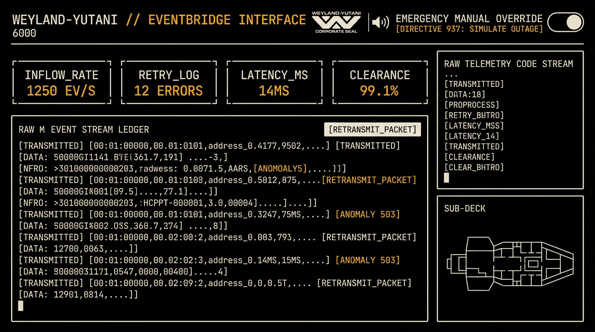

- **Aesthetic**: Authentic *Alien (1979)* Nostromo ship computer.
- **Palette**: Pure Pitch Black (`#000000`) + Phosphor Amber (`#FFB000`) + Bone White (`#EDE6D6`).
- **Key Features**: Active terminal block cursor `█`, `[DIRECTIVE 937: OUTAGE]` override switch, `[RETRANSMIT_PACKET]` button, and spaceship sub-deck wireframe floorplan map.

---

### Concept 5: 1980s Vector Wireframe Oscilloscope

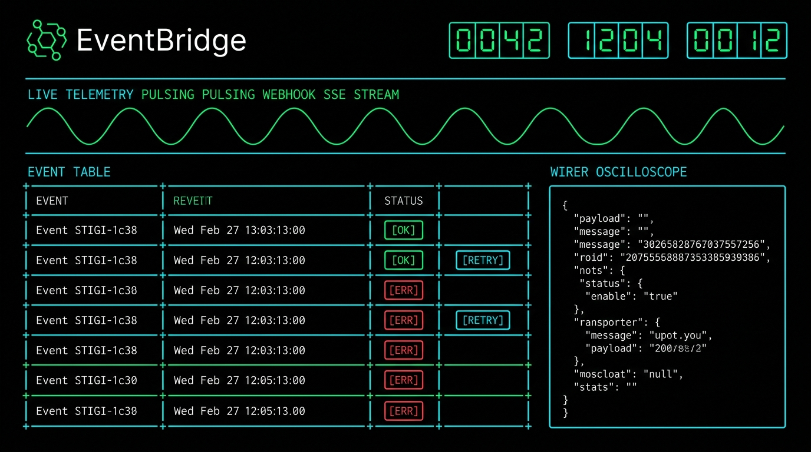

- **Aesthetic**: 1980s Vector graphics / Radar & Oscilloscope green wireframe.
- **Palette**: Pitch Black + Electric Vector Green (`#00FF66`).
- **Key Features**: 1px crisp vector borders, live sine-wave pulse wire, radar targeting reticles.

---

## 3. Category B: Retro Gaming & Handheld Consoles

### Option 17: Game Boy Color / 1990s Pocket Console UI

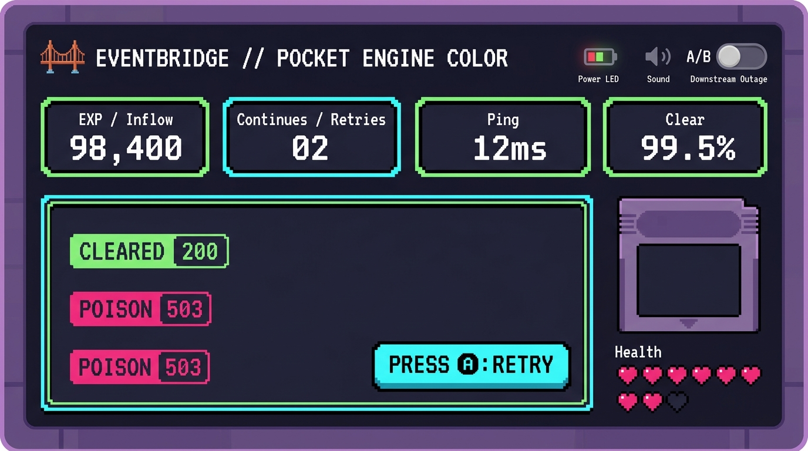

- **Aesthetic**: 1990s Nintendo Game Boy Color Handheld.
- **Palette**: Atomic Purple Console Bezel + Game Boy Lime (`#76C893`) + Berry Pink (`#F72585`) + Cyan.
- **Key Features**: 8-bit pixel bridge sprite icon, battery power LED indicator, game stat boxes (`EXP`, `Continues: 02`, `Ping: 12ms`), `PRESS Ⓐ: RETRY` button, cartridge slot payload viewer, and pixel heart health bar (♥♥♥♥♥).

---

### Concept 4: Neo-Brutalist Arcade Flat Console

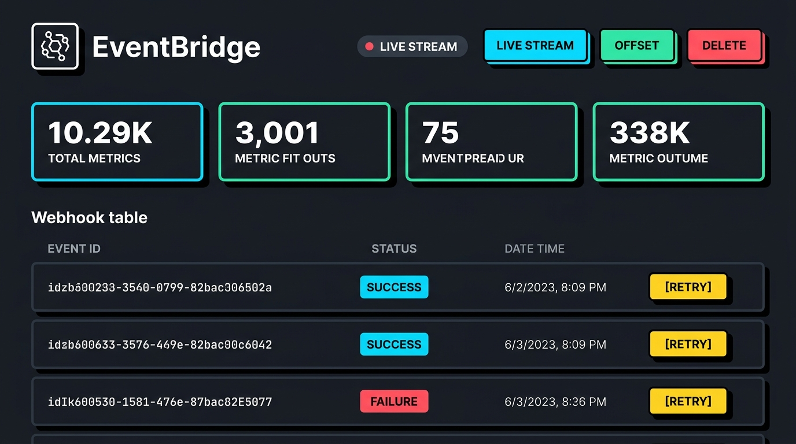

- **Aesthetic**: High-impact Neo-Brutalist Pop Arcade.
- **Palette**: Dark Slate + Arcade Yellow (`#FFE600`) + Coral Red (`#FF5C5C`) + Pure White.
- **Key Features**: Bold 2px solid black borders, hard 3px offset drop-shadows with zero blur, vibrant chips, and chunky tactile buttons.

---

### Option 20: 1980s Casio Databank Digital LCD Watch Console *(Architectural Spec)*
- **Aesthetic**: 1980s Casio Databank 50-Telememo Wristwatch.
- **Palette**: Resin Black (`#1A1C20`) + Olive LCD Panel (`#7D9D64`) + Black Segmented Digits.
- **Key Features**: 7-segment digital LCD digits (`88:88:88`), watch-pusher toggle `[OUTAGE: OFF/ON]`, dot-matrix ledger rows, and a databank phonebook/memo payload register.

---

## 4. Category C: Physical Hardware & Studio Audio Consoles

### Option 10: Braun / Dieter Rams Minimalist Industrial Console

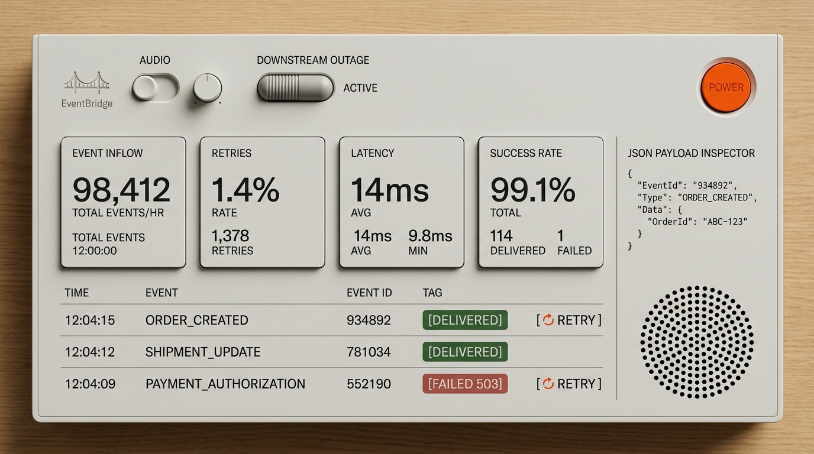

- **Aesthetic**: 1960s German Functionalism (*"Weniger, aber besser"* / "Less, but better").
- **Palette**: Matte Warm Grey Chassis (`#E8E8E4`) + Deep Graphite (`#1C1D1F`) + Iconic Braun Orange (`#FF5500`).
- **Key Features**: Ribbed physical rocker switch for outage toggle, circular perforated speaker grill for audio feedback, pristine editorial ledger, and tactile circular `[ ⟳ RETRY ]` buttons.

---

### Option 11: Studio Audio Patchbay & Modular Synthesizer

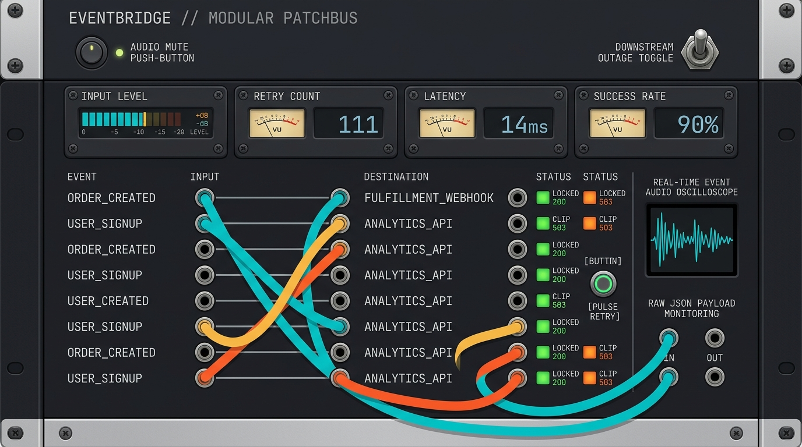

- **Aesthetic**: Analog Studio Rackmount Audio Gear (Moog / Buchla Studio Console).
- **Palette**: Dark Studio Aluminum (`#1E2127`) + Electric Cyan (`#00D2D3`) + Gold + Signal Orange.
- **Key Features**: Flat color-coded virtual patch cables connecting events to webhook destination jacks, analog needle VU meters, live audio oscilloscope wave display, and `[PULSE RETRY]` push-buttons.

---

### Option 13: 1970s NASA Apollo Mission Control Wall

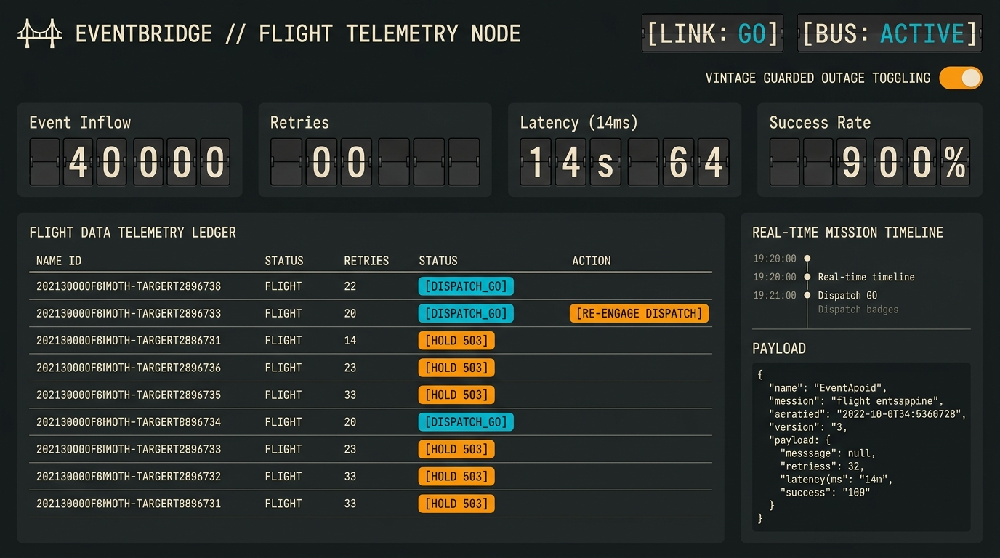

- **Aesthetic**: NASA Houston Apollo / Skylab Telemetry Board.
- **Palette**: Dark Aerospace Charcoal (`#181C1D`) + Warm Ivory (`#F2E9D8`) + Flight Cyan + Amber.
- **Key Features**: Mechanical split-flap digit counter boards (`40000`, `14s`, `90%`), backlit `[LINK: GO]` tiles, vertical mission timeline, and tactile `[RE-ENGAGE DISPATCH]` buttons.

---

### Concept 1 Flat: Retro Industrial Hardware Console (Teenage Engineering style)

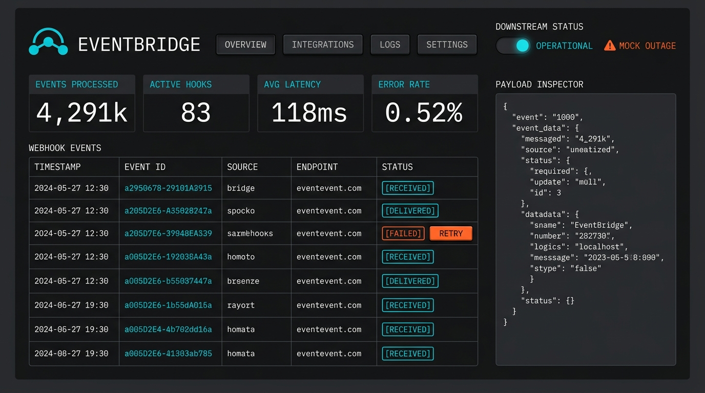

- **Aesthetic**: Teenage Engineering OP-1 Hardware Console.
- **Palette**: Matte Anodized Aluminum Grey + Signal Orange + Steel Blue.
- **Key Features**: Physical toggle switches, rotary dial indicators, LED dot-matrix display, tactile hardware chassis.

---

## 5. Category D: Modernist, Editorial & Architectural Consoles

### Option 12: Swiss International Typographic Poster Console

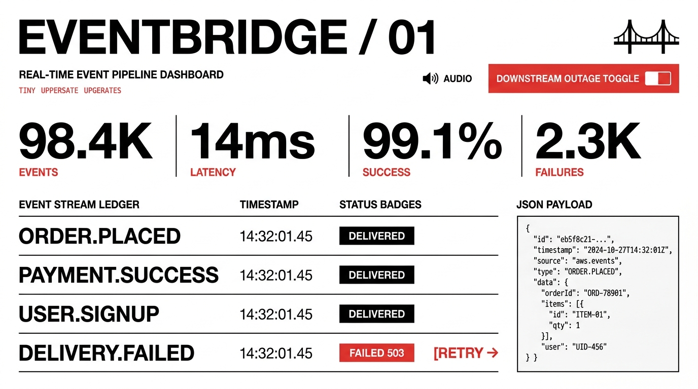

- **Aesthetic**: Mid-Century Modernism & Bauhaus (Josef Müller-Brockmann).
- **Palette**: Pure White (`#FFFFFF`) + Pure Black (`#000000`) + Vivid Swiss Vermilion (`#E53935`).
- **Key Features**: Giant authoritative Helvetica metrics (`98.4K`, `14ms`, `99.1%`) with hairline dividers, bold event ledger (`ORDER.PLACED`), and stark red `[RETRY →]` text buttons.

---

### Option 19: Soviet Constructivist / Russian Avant-Garde Poster

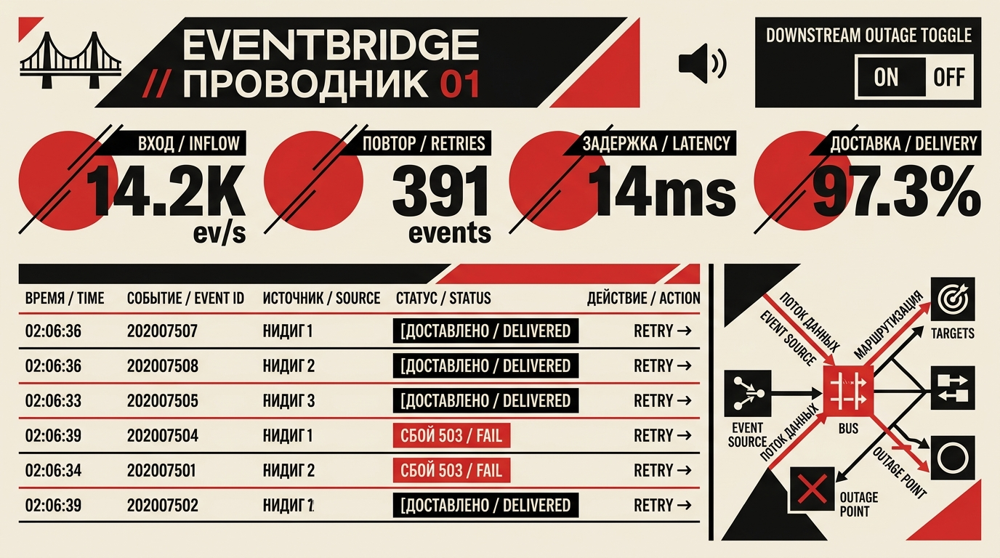

- **Aesthetic**: 1920s Constructivist Poster Art (El Lissitzky & Alexander Rodchenko).
- **Palette**: Warm Newsprint Cream (`#F2ECE1`) + Pitch Black (`#111111`) + Constructivist Red (`#D32F2F`).
- **Key Features**: Massive bold black numbers slashed across giant flat red circles, dynamic diagonal rules, `[ДОСТАВЛЕНО / DELIVERED]` stamps, and a geometric event pipeline diagram.

---

### Option 15: Nordic Dark / Scandinavian Architectural Console

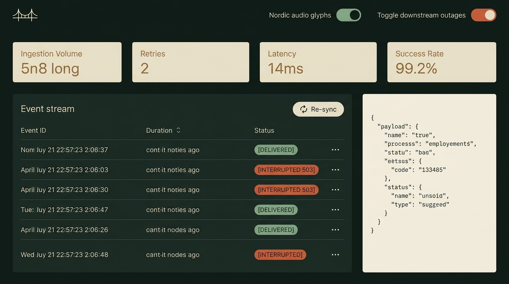

- **Aesthetic**: Danish Modernism & High-End Acoustic Design (Bang & Olufsen / Kvadrat).
- **Palette**: Deep Spruce Forest (`#0D1714`) + Warm Oat Beige (`#E6DEC9`) + Terracotta + Pale Sage.
- **Key Features**: Floating warm oat cards, generous calm typography, muted terracotta outage toggle, pale sage status pills, and organic `[ ⟳ Re-sync ]` buttons.

---

### Concept 7: Japanese Zen & Warm Paper Console

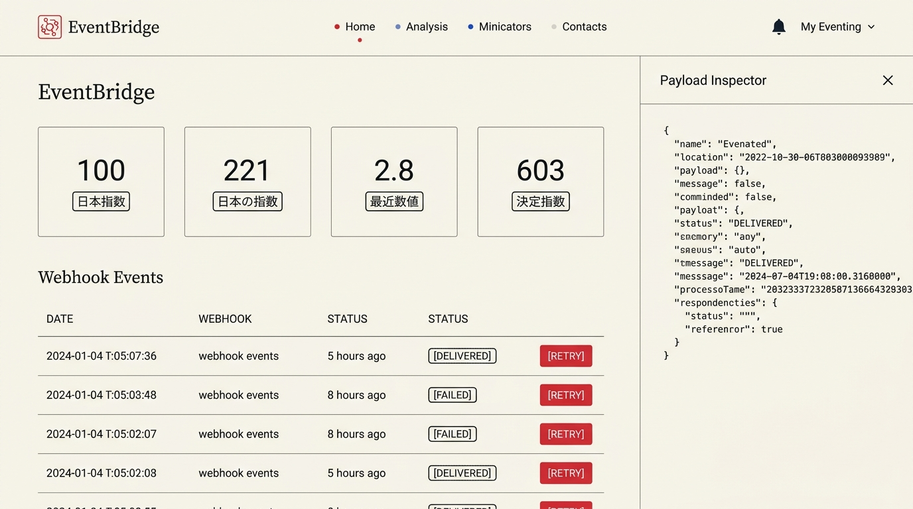

- **Aesthetic**: Museum-grade Japanese Paper & Sumi-Ink Minimalism.
- **Palette**: Warm Cream Paper (`#F8F6F0`) + Sumi-Ink Black + Vermilion Red.
- **Key Features**: Traditional Japanese vermilion seal stamps (`[DELIVERED]`, `[FAILED]`), delicate grid dividers, serene and calm layout.

---

### Concept 9: Modular Asymmetric Bento Grid Station

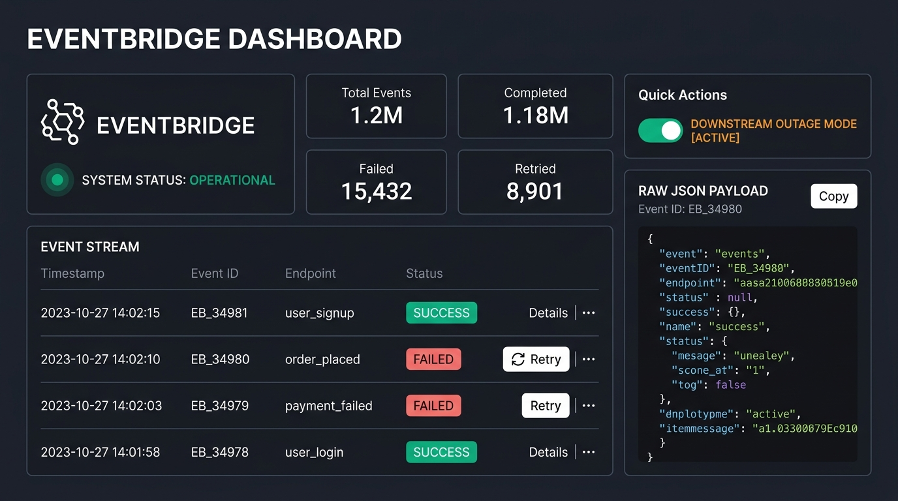

- **Aesthetic**: Modern Modular Bento Compartments (Apple / Linear style).
- **Palette**: Deep Slate (`#13151A`) + Flat Container Gray (`#1C1F26`) + Hairline Borders (`#2E333D`).
- **Key Features**: Asymmetric bento compartments, quick-actions card, clean pill badges.

---

### Concept 6: CAD Engineering Blueprint

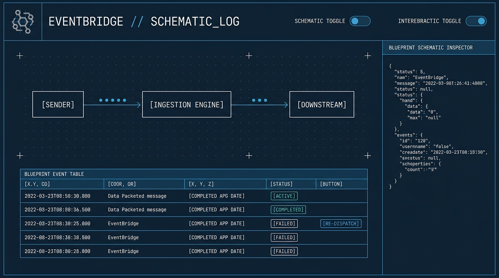

- **Aesthetic**: Technical Drafting Blueprint Schematic.
- **Palette**: Blueprint Navy (`#0A192F`) + Technical White + Cyan Drafting Lines.
- **Key Features**: Drafting coordinate grid, isometric pipeline diagram, technical measurement tags.

---

### Option 21: Transit Metro / Subway Map Schematic *(Architectural Spec)*
- **Aesthetic**: Massimo Vignelli NYC Subway / London Underground Transit Diagram.
- **Palette**: Porcelain White or Night Slate + Color-Coded Transit Lines (Red, Blue, Yellow).
- **Key Features**: Color-coded routes connecting incoming webhooks to target nodes, station dot indicators (`[STATION: 200]`), and `[REROUTE / RETRY]` action buttons.

---

## 6. Category E: Initial Explorations (Historical Reference)

### Concept 1: Obsidian Glassmorphism *(Initial Round - Rejected due to gradients)*

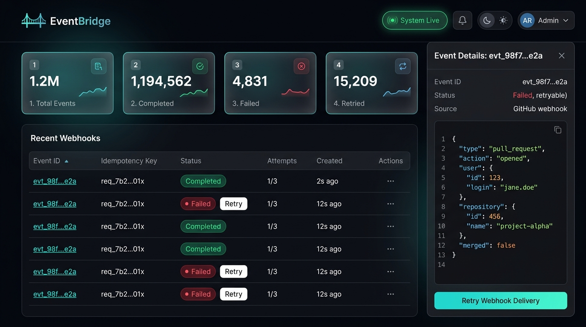

---

### Concept 2: Stripe Dark Engineering Workbench

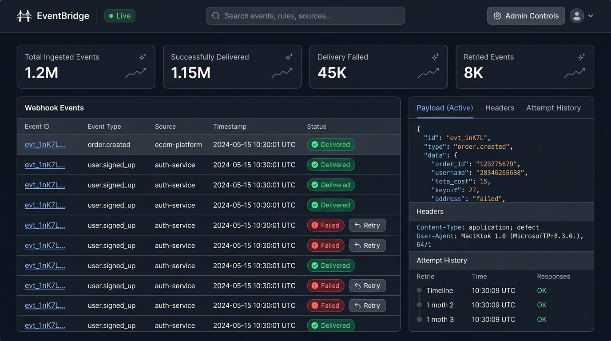

---

### Concept 3: Raycast Floating Island Command Bar

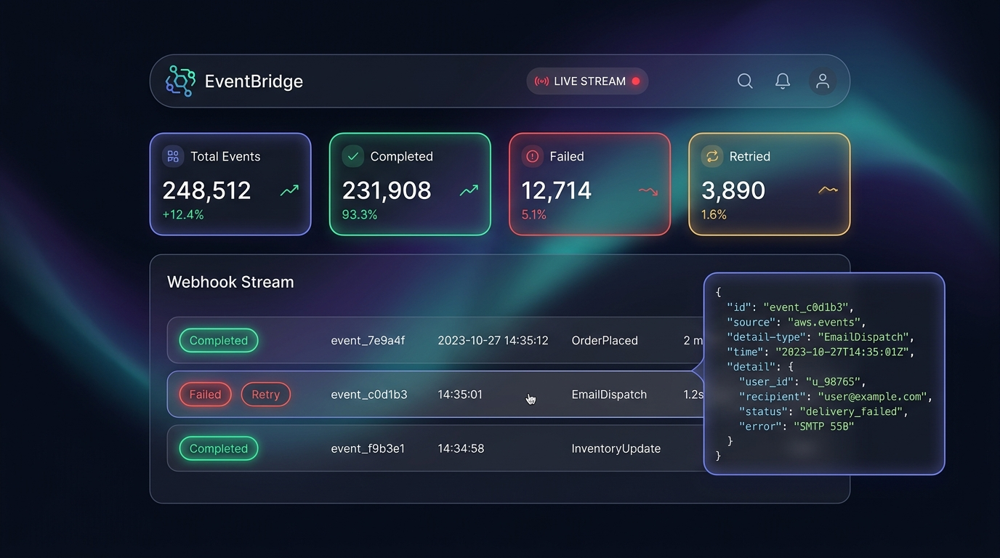

---

### Concept 2 Flat: Retro Monospace ASCII Cyber Terminal

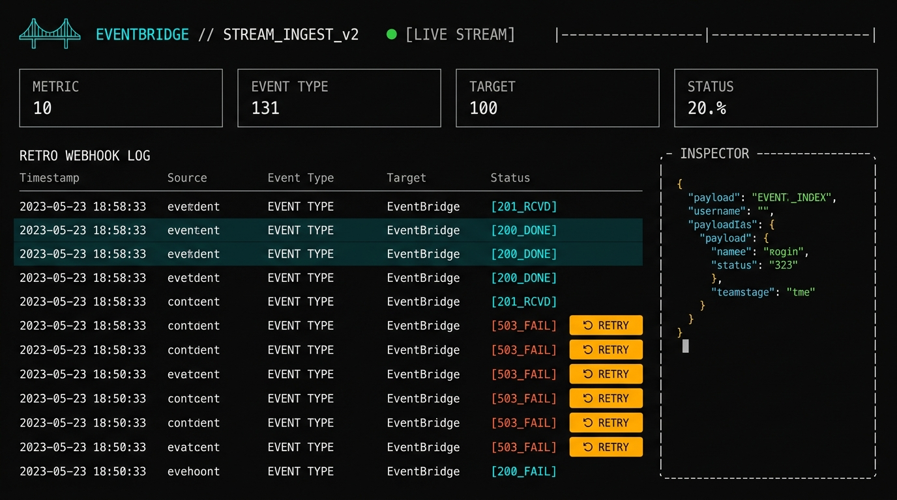

---

### Concept 3 Flat: Modern Swiss Flat Workstation

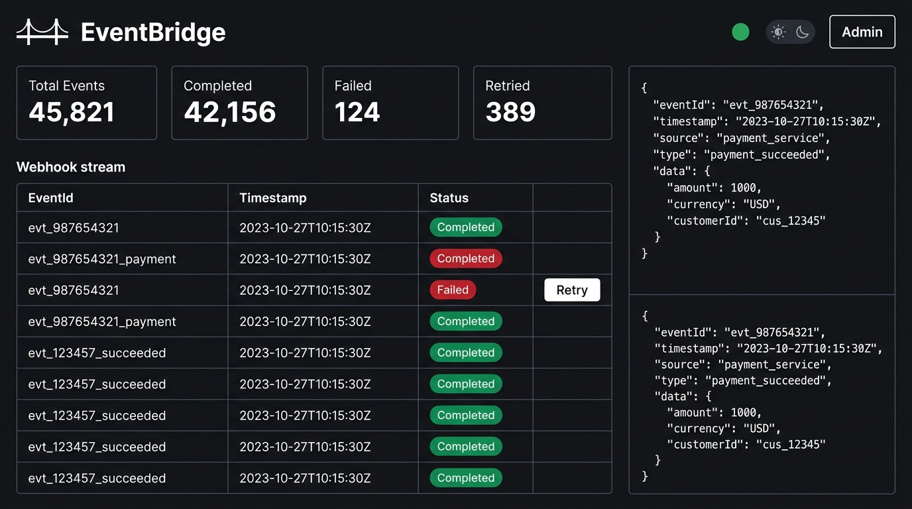

---

## 7. Comprehensive Comparison Matrix

| # | Concept Name | Primary Aesthetic | Palette | Outage Toggle Style | Retry Action Style | Status Badges Style |
|---|---|---|---|---|---|---|
| 🏆 8 | **Cyberpunk Tactical HUD** | Sci-Fi Tactical Console | Void Black + Laser Cyan/Amber | Tactical Pill Slider | `[RETRY_DISPATCH]` | Reticle Brackets `┌ ┐` |
| 🏆 14 | **16-Bit Arcade Engine** | Neo-Geo Arcade Operator | Dark Indigo + Purple/Gold | Red Arcade Toggle | `[1-UP RETRY]` | Scoreboard Chips |
| 8A | **NERV MAGI Command Node** | Evangelion Military Defense | Carbon + Safety Amber/Orange | Hazard Alert Banner | `[ ⟳ OVERRIDE_RETRY ]` | Solid Alert Blocks |
| 8B | **Arasaka Cyberdeck** | Cyberpunk 2077 Netrunner | Obsidian + Acid Yellow/Red | `[ICE INTRUSION TRIGGER]` | `[DAEMON_RESYNC]` | Memory Hex Badges |
| 8C | **Spacecraft Avionics** | Apollo Avionics Glass Cockpit | Slate + Vector Green/Teal | Guarded Cockpit Switch | `[RE-ENGAGE]` | Backlit Annunciator Tiles |
| 8D | **WipEout / tDR HUD** | Anti-Gravity Racing UI | Black/White + Magenta/Cobalt | `[KILL-SWITCH]` | `[BOOST_RETRY]` | Barcode Serials `|||||` |
| 10 | **Braun Dieter Rams** | 1960s German Functionalism | Matte Warm Grey + Orange | Ribbed Rocker Switch | `[ ⟳ RETRY ]` | Minimalist Printed Ledger |
| 11 | **Studio Audio Patchbay** | Modular Synthesizer Rack | Aluminum + Patchcords | Heavy Metal Toggle | `[PULSE RETRY]` | LED Status Indicators |
| 12 | **Swiss Typographic Poster** | Bauhaus / International Style | Pure White + Vermilion Red | Red Block Switch | `[RETRY →]` | Bold Black/Red Blocks |
| 13 | **Apollo Mission Control** | 1970s NASA Houston Wall | Charcoal + Ivory/Amber | Vintage Guarded Switch | `[RE-ENGAGE DISPATCH]` | Split-Flap Readouts |
| 15 | **Nordic Dark Architectural** | Danish Acoustic Showroom | Spruce Forest + Oat Beige | Terracotta Slider | `[ ⟳ Re-sync ]` | Soft Pale Sage Pills |
| 16 | **Armored Mecha Cockpit** | Gundam / Armored Core HUD | Stealth Carbon + Hazard Orange | Hydraulic Breaker | `[HYDRAULIC_REENGAGE]` | Exoskeleton Reticles |
| 17 | **Game Boy Pocket Console** | 1990s Handheld Console | Atomic Purple + Lime/Berry | A/B Switch | `[PRESS Ⓐ: RETRY]` | Game Boy LCD Chips |
| 18 | **Weyland-Yutani 6000** | *Alien (1979)* Nostromo Computer | Pitch Black + Phosphor Amber | `[DIRECTIVE 937]` Switch | `[RETRANSMIT_PACKET]` | Monospace Block Cursor |
| 19 | **Soviet Constructivist** | 1920s Avant-Garde Poster | Newsprint Cream + Red/Black | High-Contrast Dual Switch | `[RETRY →]` | Cyrillic / English Stamps |
| 20 | **Casio Databank Watch** | 1980s Digital Telememo Watch | Resin Black + Olive LCD | Watch Pusher Button | `[ADJUST / RETRY]` | 7-Segment Digits |
| 21 | **Transit Metro Schematic** | Vignelli Subway Map | Porcelain White + Transit Lines | Signal Interruption Switch | `[REROUTE / RETRY]` | Transfer Station Dots |
| 4 | **Neo-Brutalist Arcade** | Pop Brutalism | Slate + Arcade Yellow/Coral | Chunky Beveled Switch | Hard-Shadow Button | 2px Border Chips |
| 5 | **Vector Wireframe HUD** | 1980s Oscilloscope | Pitch Black + Phosphor Green | Wireframe Toggle | Vector Reticle Button | 1px Green Outlines |
| 6 | **CAD Blueprint** | Architectural Drafting | Blueprint Navy + White/Cyan | Drafting Switch | Schematic Node Trigger | Drafting Box Tags |
| 7 | **Japanese Zen Paper** | Muji / Japanese Architecture | Cream Paper + Sumi-Ink | Minimal Ink Slider | Vermilion Stamp Button | Red Seal Stamps |
| 9 | **Modular Bento Grid** | Apple / Linear Bento Workstation| Deep Slate + Flat Gray | Quick-Actions Card Switch | White Pill Button | Pill Badges |

---

## 8. Implementation Readiness Guide

When you make your choice and are ready to proceed:
1. **Branch**: We are currently on `UI-testing`, fully merged and synchronized with `main` (`20adb08`).
2. **Components to Style**:
   - `client/src/App.jsx`: Main shell layout, live connection status beacon, KPI metric cards, downstream outage banner.
   - `client/src/App.css`: All CSS custom properties, zero-gradient color palettes, chamfer/corner clip-paths, fonts, and animation keyframes.
   - `client/src/components/WebhookTable.jsx` / `EventTable.jsx`: Telemetry stream row styling, status badges, and single-click retry action buttons.
   - `client/src/components/EventDetails.jsx`: Payload inspector formatted according to your chosen archetype (Delivery Route Tree, Hex/Memory Dump, Game Cartridge Slot, or Transit Map).
   - `client/src/components/AdminPanel.jsx`: Downstream outage simulation toggle and admin controls.
   - `client/src/utils/sound.js`: Theme-aligned audio feedback.
3. **Strict Constraints Maintained**: 100% zero gradients, pure flat surfaces, sharp contrast, and full preservation of existing functionality.
